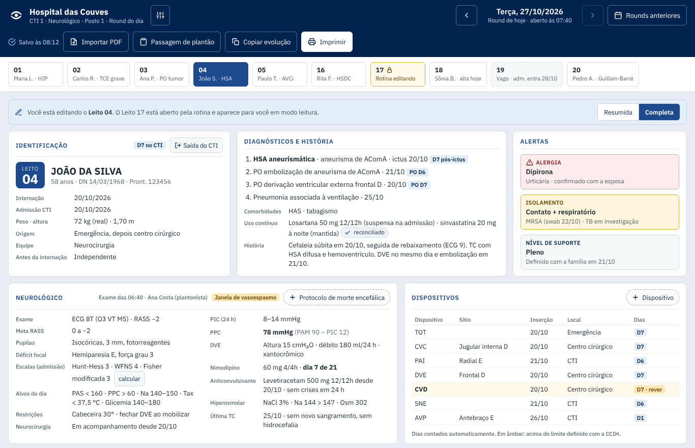

# CriticalEye


**Cada paciente, um olhar atento.** A structured daily round app for the adult ICUs of a public (SUS) hospital in Rio de Janeiro. Doctors keep one record per bed per day, the next day starts as a copy, and the app produces the progress-note text, the shift handoff and a printed sheet.

> **Status: design stage.** The screens, fields and rules are specified and clickable, but there is no production code yet: no storage, no login, no PDF parser, no deployment. The beta will cover CTI 1 (neuro, 20 beds in two nursing stations) and CTI 2 (post-op, 10 beds).



## Start here

1. **[Status report](docs/status-report.md)** (English, about 10 minutes): context and constraints, what exists, the proposed architecture, open decisions and a suggested build order.
2. **The prototype:** clone the repo and open `prototype/index.html` in Chrome, Edge or Firefox. It runs straight from the file system, with no server or install. Or browse the [screenshots](prototype/screenshots/).
3. **[Requirements report](docs/requisitos.md)** (Portuguese): the field-by-field spec (section 6), storage and data protection (LGPD), the daily routine and the pilot plan.
4. **[Response to the technical review](docs/review-response.md)** (English, 31 Oct 2026): the decision on each of the reviewer's 28 proposals. Where it differs from the two reports above, the response wins until they are updated. The pilot now starts in CTI 5, a 6-bed clinical/general ICU.

## What's in the repo

```text
docs/
  status-report.md     where the project stands, written for developers (English)
  review-response.md   decisions on the technical review (English)
  requisitos.md        full requirements report (Portuguese)
  img/                 architecture diagram and the image above
prototype/
  index.html           gallery of the 18 screens: start here
  screens/             runnable copy of each screen (generated)
  screenshots/         full-page PNG of each screen, 1366 px wide
  source/              the screens as drawn in the design canvas (*.dc.html), canvas.json, icon and logo
  viewer/              dc-lite.js (small runtime), build.mjs, screenshots.cjs
```

## About the prototype code

The screens were drawn in a design canvas in Claude. Each `source/*.dc.html` file holds the markup, with `{{bindings}}`, `<sc-if>` and `<sc-for>` blocks, plus a small `Component` class whose `renderVals()` returns the values and event handlers. Those files need the canvas runtime, so `viewer/dc-lite.js` (under 300 lines) stands in for it, and `viewer/build.mjs` wraps each screen into a page under `screens/`. See [prototype/README.md](prototype/README.md).

The `Component` classes are the closest thing to a reference implementation. `Branco.dc.html` and `Cti2.dc.html` contain the infusion-dose, fluid-balance, urine-output, CKD-EPI 2021 eGFR and day-count calculations, the device catalogue with insertion sites, and the antibiotic form with the restricted drugs. Since the review they also validate volumes and dates, keep blank apart from zero, and render devices, drains and antibiotics as lists of any length. Nothing is saved: a reload resets the screen.

```sh
node prototype/viewer/build.mjs        # regenerate screens/ and index.html from source/ (Node 18+)
node prototype/viewer/screenshots.cjs  # regenerate screenshots/ (needs Playwright)
```

## Ground rules

- **No real patient data, ever.** Every name, date and number in the screens is fictional ("Hospital das Couves"). The hospital PDFs used to design the imports were real patient documents and are not in this repo; `.gitignore` blocks PDFs as a safeguard.
- **No clinical suggestions.** The app only computes from what the doctor entered. It never suggests a conduct or a dose.
- **Plain output text.** Text for the hospital record system (TI MED) uses only letters, digits, accents and `/ - : > < + % , . ( )`, because other symbols turn into "?" when pasted.

## Copyright

© 2026 Matheus Barros. All rights reserved. This repository is shared for review. No license is granted to use, copy, modify or distribute its contents.
