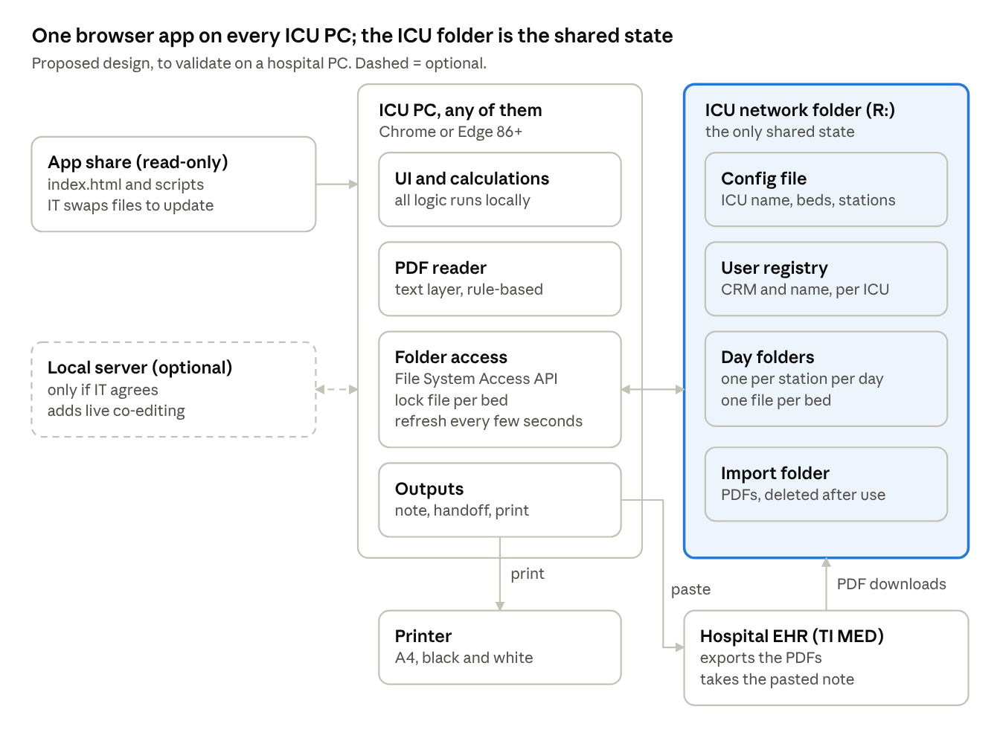

# CriticalEye — development status report

Matheus Barros · 31 Oct 2026 · copy of the report kept in Claude

## Summary

CriticalEye is at the end of the design stage: the screens, fields and rules are specified and clickable, but no production code exists yet. There is no storage layer, no login, no PDF parser and no deployment.

It is a structured daily ICU round for two units of a public (SUS) hospital in Rio de Janeiro. Doctors fill one record per bed per day, the next day starts as a copy, and the app produces the progress-note text, the shift handoff and a printed sheet. The beta targets CTI 1 (neuro, 20 beds in two nursing stations) and CTI 2 (post-op, 10 beds).

The next step is turning the prototype into a working app inside strict constraints: old Windows PCs, no cloud, data only on the hospital network folders. The hardest technical question is storage and concurrency without a server (see Proposed technical approach).

## Context and constraints

The hospital environment rules out the usual stack: no cloud, no installs, no server today. Every constraint below comes from the hospital or from decisions already written in the requirements report.

| Constraint | What it means for the build |
| --- | --- |
| Old Windows PCs; no Word; LibreOffice crashes | Browser-only app. Printing goes through the browser. |
| Google Docs and personal drives vetoed under LGPD (Brazil's data protection law) | No cloud storage. Data stays in the hospital network. |
| IT already created one network folder per ICU; access is set by folder permissions | The folder is the database. Folder permissions are the real access control. |
| No server available today | File-based storage. Live co-editing (seeing others type) would need a small local server, which depends on IT. |
| Each doctor logs into Windows with their own profile; CTI 2 shares the coordinator's profile | A one-time "connect the ICU folder" step per Windows profile. Nothing important may live only in one profile. |
| Requirement set in the report: Chrome or Edge 86+ | Plan is the browser's File System Access API (folder picker) on a mapped drive such as R:. |
| The hospital EHR (TI MED) turns symbols like the middle dot into "?" when pasted; accents are fine | Generated text uses only letters, digits, accents and / - : > < + %. |
| The printer is black and white only | A separate print layout, no filled areas, alerts marked by icon and double borders. |
| Patient data | Prototypes use fictional data only. Imports ignore CPF, CNS and mother's name, and imported PDFs are deleted after use. |
| Clinical safety | No conduct or dose suggestions. The app only calculates from what the doctor entered. |
| Users | Doctors identify by CRM (medical licence number, any length, not a password) and pick a role each session (routine or on-call). Admin staff (ADM) get a limited role. |

## What exists today

Three assets exist: a clickable prototype with 18 screens, a requirements report in Portuguese, and an earlier personal rounding app. None of them is the production app.

**1. Clickable prototype (in this repo: [`prototype/`](../prototype/)).** Each screen is a standalone HTML artboard with fictional patients. Some logic already runs in plain JavaScript inside the screens (dose, fluid balance, eGFR, day counts, the device and antibiotic lists), so it can serve as a reference implementation. Nothing is saved: a reload resets every screen.

| Screen | What it shows | Clickable logic |
| --- | --- | --- |
| Connect folder | First run in a Windows profile: guided pick of the ICU network folder | No |
| Entry | CRM login, first-access name, role (routine or on-call), nursing station, "Enter as ADM" | Yes |
| ADM entry | Admin staff enter labs, blood gas, last-24 h vitals and skin; fluid balance and devices are read-only | No |
| Open the day | Today's round created as a copy of yesterday's, without discharges, plus new admissions | No |
| Station map | Bed cards with tags (isolation, sepsis, brain-death protocol, palliative), locks, previous days | No |
| Bed, full view | Every section for one patient, print dialog, "Leave the ICU" menu, copy note | Yes |
| Bed, summary view | Accordion view proposed as the default | Yes |
| Blank bed, CTI 1 | Data entry with per-bed section toggles, device list feeding the fluid balance, dose and eGFR calculators, antibiotic form | Yes |
| Blank bed, CTI 2 | Same in the CTI 2 green theme, with post-op and vascular-surgery blocks | Yes |
| Palliative care | Palliative section for one patient, with PDF imports from the palliative team, psychology and social service | No |
| Brain-death protocol | ICU part of the protocol, timing between clinical exams | Yes |
| Copy progress note | The generated plain-text note | Yes |
| Shift handoff | Handoff per station, filter, receiver confirms by CRM | Yes |
| Print preview | A4 landscape black-and-white sheet | No |
| Import previous note | What the app extracts from a progress note written in another ward | No |
| Import operative report | Mapping of a surgery report into the surgery, device and culture sections | No |
| Import prescription | Mapping of the daily prescription into antibiotics, infusions, nutrition and prophylaxis | No |
| Reports and consults | Where imaging reports and consult answers land in the round | No |

**2. Requirements report ([`docs/requisitos.md`](requisitos.md), in Portuguese).** It holds the field-by-field spec (sections 6.1 to 6.19), the storage decision, the daily routine, open decisions, questions for IT and the pilot plan with indicators.

**3. Ronda CTI, an earlier app by Matheus.** It is a React PWA for his own phone, with 10 fixed beds and data in localStorage. Its device catalogue, the unit's standard drug concentrations and the CKD-EPI 2021 formula were reused in CriticalEye. It has no shared storage, so it is a source of catalogues, not a base for the new app.

## Functional scope designed so far

The scope is one record per bed per day, copied forward each morning, plus three outputs: note text, handoff and print. The table lists the behaviour already agreed and drawn; details per field are in the report's section 6.

| Area | Designed behaviour |
| --- | --- |
| Daily round | One round per nursing station per day (CTI 1 has two stations; CTI 2 has one). Whoever arrives first, doctor or ADM, opens the day. Past days are read-only. |
| Copy-forward | The new day copies every patient except those discharged. Identification, diagnoses, alerts, devices and antibiotics (one day added), cultures, protocols, palliative care and open to-dos carry over. Today's labs, blood gas and balance become "previous". Neuro exam, infusions and ventilation come for review. Last 24 h and the day's plan start empty, with a "copy yesterday's plan" button. |
| Admissions and discharges | "Leave the ICU" (discharge, death or transfer) is recorded the same day, so the bed is not copied. Admissions join the next day's round. Only doctors can undo a discharge. |
| Bed sections | Identification, alerts (allergy, isolation, support level), diagnoses, devices, haemodynamics and infusions, respiratory, last 24 h, fluid balance, infection (antibiotics, cultures, isolation, sepsis), labs, imaging, prophylaxis, nutrition, skin, free-text plan, to-dos, family, palliative care. |
| Optional blocks per bed | Neuro (with neurosurgery follow-up status and the brain-death protocol), surgery and post-op (with a vascular block), elderly hip-fracture protocol. Any of them can be switched on in either ICU. |
| Views | Summary view by default (accordion rows), full view on request. No mandatory scales; plain-language options where the team does not use a scale. |
| Concurrency | One file per bed. The first person to open a bed holds it; others see it read-only. Changes show on other PCs within seconds. |
| Roles | Doctors: everything. ADM: labs, blood gas, imaging reports, last-24 h vitals, bowel movements, skin; fluid balance and devices are read-only for them. Every entry shows who made it and when. |
| Configuration | ICU name, colour, beds, stations and isolation beds live in a config file inside the ICU folder. CTI 1 uses the brand navy, CTI 2 green. |

**Calculations (already written in the prototype's JavaScript).** All of them only compute from entered data:

- Infusion dose = pump rate (ml/h) × final concentration ÷ weight, in each drug's unit (mcg/kg/min, mcg/h, mg/h, UI/min). Fourteen drugs come with the unit's standard concentrations, editable per bed.
- Fluid balance = total intake (one number from the nursing sheet) − (urine + each drain + dialysis ultrafiltration + other losses). Each drain in the device list gets its own loss line, with yesterday's output beside it.
- Urine output in ml/kg/h, age from date of birth, eGFR by CKD-EPI 2021, cerebral perfusion pressure (MAP − ICP).
- Day counters: D = today − D0, where D0 is the insertion date or the day of the first antibiotic dose. Also post-op day, hours from hip fracture to surgery, and the interval between brain-death clinical exams.

**Outputs.**

- Progress-note text for the EHR: one item per line, a blank line between sections, only the allowed characters. Devices and antibiotics read like "D7 (D0 20/10 - CC) PVP VJID". No antibiotic dosing, physical exam left blank.
- Shift handoff per station: situation chosen by the giver, filter for unstable patients, receiver confirms with their CRM. Copyable text in the same format.
- Print: A4 black and white, 1 bed per sheet (landscape) or 2 per sheet (portrait). Choose all occupied beds, this bed, or picked beds.

## Hospital PDF imports

The hospital's own PDFs carry a text layer, so the app can read them locally with rule-based parsing and no OCR. Matheus sent one sample of each type on 30/10; every one had a text layer. The app detects the type by the document title, shows what it found, and saves nothing until the doctor confirms.

| Document | What the app extracts | Where it goes |
| --- | --- | --- |
| Progress note from another ward ("EVOLUÇÃO MÉDICA") | Identification, admission date and ward of origin; diagnoses and surgeries with dates; comorbidities; allergies; tests cited with dates; current antibiotics with start date and focus; devices with site and date; ventilation flags | Identification, diagnoses, alerts, infection, devices, respiratory, imaging and labs. Physical exam and plan stay in the PDF. |
| Operative report ("Relato Cirúrgico") | Procedure, date and time, specialty and surgeon, urgency, anaesthesia, wound class, blood products, prophylaxis, histopathology, ICD code; from the free text, drains and stomas with site, samples sent for culture, events | Surgery section (post-op day computed), devices and fluid balance, cultures, to-dos (histopathology result). Vascular cases switch on the vascular block. |
| Daily prescription ("Prescrição") | Weight and allergies; antibiotics with the counter "D (x / y)" and the justification; continuous infusions with their dilution; steroids; diet and parenteral nutrition; VTE and stress-ulcer prophylaxis; glucose and insulin scheme | Alerts, infection (no dosing), infusions (pump rate is still typed at the bedside), nutrition, prophylaxis. Symptom drugs and nursing orders stay in the PDF. |
| Imaging reports and echo | Exam, date and summary: the "Impressão diagnóstica" when present; for echo, ejection fraction and main findings | Imaging |
| Consult answer ("Parecer") | Requesting and answering specialty, request and answer dates, conclusion, requests made in the text | Palliative care (answers from the palliative team), neurosurgery status (answers from neurosurgery), to-dos |

Rules that already shape the parsers:

- The PDF is read in the browser and deleted from the import folder after use. CPF, CNS, mother's name and signatures are ignored.
- Prescription dilutions match the unit's standard concentrations in the app, so the app can flag a non-standard one.
- The prescription's "D (x / y) de N" is not trusted for start dates. When the first dose is given the evening before, the next day's prescription still says D1. The app only suggests D0 on the first import; the doctor confirms it, and the round keeps it afterwards. Nobody knows yet what "de N" means.
- Samples still missing: lab results (and blood gas, if separate), a neurosurgery operative report, psychology and social-service notes.
- The samples were real patient documents. Anyone writing parsers should work from redacted copies.

## Proposed technical approach

The agreed direction is a browser app with no server: every ICU PC opens the same files from a read-only network share, and all shared state lives as files in the ICU's network folder. The drawing shows the parts; what is already decided and what is only proposed are listed under it.



Arrows show who reads or writes what. The dashed box exists only if IT agrees to run a small local server.

**Already decided in the requirements report:**

- One copy of the app on a read-only network share. IT replaces the files to release a new version, and puts a shortcut on the Windows Public Desktop so it shows in every profile.
- Chrome or Edge 86 or newer. On the first run in each Windows profile, a guided step connects the ICU folder, ideally mapped as a drive such as R:. After that the browser at most asks to confirm access.
- One folder per ICU, a subfolder per nursing station, a folder per day, one file per bed, and a config file in the ICU folder.
- No server. Seeing a colleague type in real time would need a small local server, which depends on IT.

**Proposed, to discuss:**

```text
R:\                      ICU folder (example layout)
  config.json            ICU name, colour, beds, stations, isolation beds
  users.json             CRM -> name, registered once per ICU
  posto-1\
    2026-10-28\
      round.json         who opened the day, discharges, admissions
      leito-04.json      that bed's record for the day
      leito-04.lock      who holds the bed, plus a heartbeat time
  entrada\               PDFs waiting for import, deleted after use
```

- JSON with a schema version in every file. Write to a temporary file, then rename, so a reader never sees half a record.
- Locks as small files holding the user and a heartbeat; a lock goes stale after an idle time the chief still has to set.
- Other PCs pick up changes by polling file timestamps every few seconds.
- PDF text through pdf.js bundled with the app (do not assume internet), one parser per document type, chosen by the document title.
- Print through a print stylesheet; generated text filtered to the characters the EHR accepts.

**Risks to test first:** whether the File System Access API works from a page opened on a network share and keeps the folder permission per Windows profile; how network-share caching delays lock and change detection between PCs; old browser versions on some machines; and backup of the ICU folders, which is IT's.

## Not built yet, and what is still open

Everything that makes the app run is still to be built: storage, locking, the day cycle, login, parsers, output generation and deployment. The prototype only fixes what the screens show and how the numbers are computed.

**Still to build:**

- Storage layer on the network folder: config, user registry, one file per bed per day, history.
- Bed locking, refresh from other PCs, and conflict handling.
- Opening the day (copy-forward rules), discharges and admissions.
- Entry by CRM, first-access registration, roles and ADM permissions.
- Note, handoff and print generated from real data (today they are static examples).
- PDF parsers for the five document types, plus the import folder clean-up.
- Settings screen (ICU name, beds, stations), deployment and update path.

**Open decisions:**

| Open item | Who decides | What it affects |
| --- | --- | --- |
| CRM only, or CRM plus a 4-digit PIN | Chief | Login |
| ADM enters through one shared button, or with a staff ID | Chief | ADM login, audit trail |
| Does ADM also enter culture results | Chief | ADM permissions |
| A bed held by someone else: wait, or take over after some idle minutes | Chief | Locking |
| On a new day, neuro exam, infusions and ventilation come copied for review or empty | Chief | Copy-forward |
| Note template and section order | Chief and ICU coordination | Note generator |
| Print every shift, or only the morning round | Chief | Print |
| Handoff in a standard format such as I-PASS | Chief | Handoff screen |
| Who owns the round each shift, fixed morning time, who opens the day and until when | Chief | Day opening |
| Ask IT for a small local server for live co-editing | Chief and IT | Architecture |
| Installed browser and version on every ICU PC (requirement: Chrome or Edge 86+) | IT, to confirm | Feasibility of the folder approach |
| Map each ICU folder as a drive letter in every profile; shortcut on the Public Desktop | IT | Setup |
| Where downloaded PDFs land, and whether they can go to a round import folder | IT | PDF import |
| Data protection officer's sign-off | Hospital | Go-live |
| Meaning of "de N" in the prescription's antibiotic counter | IT or pharmacy | Prescription parser |
| Trademark search before registering the name (a UK company called Criticaleye exists) | Matheus | Branding |

**Material still to receive:** the lab and missing PDF samples listed above, the infection-control isolation list for germs other than TB, the hospital's elderly hip-fracture protocol, the palliative team's referral flow, and the general-surgery team's review of the CTI 2 post-op fields.

## Suggested build order

Start with a feasibility test on a real ICU computer, because the whole storage design depends on what the hospital's browser allows. After that, build the daily loop before any import or polish.

1. Feasibility test on an ICU PC: open the app from the read-only network share in the installed browser, pick the ICU folder, read and write files. Check whether the folder permission survives a new session and a different Windows profile. Test a lock file and change detection between two PCs. The result decides between folder-only storage and asking IT for a small local server.
2. Data model and storage: file layout, schema version, lock files, history kept per day.
3. Core loop: entry, station map, bed screen in summary view, opening the day with copy-forward, leaving the ICU.
4. Port the prototype's calculations, with unit tests for dose, fluid balance, eGFR and day counts.
5. Outputs: note text, handoff, print stylesheet.
6. PDF import: prescription, previous note and operative report first, since they save the most typing; then imaging and consults; labs once the sample arrives.
7. ADM role and the "who entered what" trail.
8. One test week with 2 or 3 colleagues, then the 4-week pilot in CTI 1 and CTI 2. The report defines the pilot indicators: devices with an insertion date, to-dos stale for over 48 h, rounds updated per shift, morning round time, team satisfaction.

**In this repo.**

- [Prototype gallery](../prototype/index.html): open it in a browser after cloning (18 screens, fictional patients)
- [Screenshots](../prototype/screenshots/) of every screen
- [Requirements report](requisitos.md), in Portuguese
